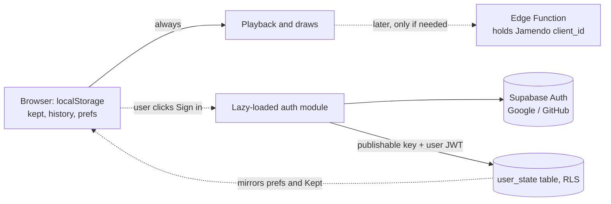

# RES-003: Optional accounts and a free-tier backend

> **Parked (owner, 2026-11-23):** kept as an open item on the [roadmap](../roadmap.md). The findings may show these features are not needed; nothing here is committed, queued or approved. Anonymous use stays the default and accounts, if ever built, stay opt-in.

> Research only. Nothing was built, installed, signed up for or changed in the app. Supabase was read through its public docs search; no project or account was created or listed.

## TL;DR

- **Question:** Can Unmarked add optional sign-in, stored preferences and server-side secrets while staying free, anonymous by default and simple?
- **Answer:** Yes. **Supabase alone covers every foreseeable need** (Auth with Google and GitHub, Postgres with RLS, Edge Functions for secrets). Its free plan has no end-user cost cap that a personal app will reach; the real risks are **project pausing after 7 idle days, no backups, and a 2-per-hour default email limit**, all manageable.
- **Design rule:** anonymous stays the default and works with **zero network calls to Supabase**. The account layer is a lazy-loaded, optional sync of data the app already keeps in `localStorage`. Signing in adds a copy; signing out or an outage loses nothing.
- **Owner decision needed:** narrowing the draw by genre or artist **contradicts the current product rule** (ADR-012, ADR-014). Narrowing by provider does not (it already exists). See "Product-rule conflict".
- **Recommendation (not fact):** Phase 1 is Google and GitHub sign-in plus one RLS-protected table that mirrors preferences and Kept. Skip email/password, anonymous sign-ins, Storage, Realtime and Vault.
- **Confidence:** High for free-tier numbers and security model (vendor pages and docs). Medium for alternatives (some pages did not state every limit; gaps are labelled). Unknown for quota-overrun behaviour on Free.

## Question and constraints

- Optional accounts: Google, GitHub, email/password; anonymous use stays the default; ability to restrict who can sign in.
- Store usernames and preferences (genres, artists, providers) to narrow the random pool, with no recommendation engine.
- Free tiers only. Privacy, security and simplicity first.
- Fixed facts about the app: static site on GitHub Pages; no runtime dependencies and no build step beyond `tools/stamp.mjs` (Verified: [PROJECT_OVERVIEW](../PROJECT_OVERVIEW.md)); it already stores `kept`, `history` and `prefs` in `localStorage` under `unmarked.v1.*` and can export and import them as JSON (Verified: `src/js/services/library.js`, 2026-11-23).

## Method

- Supabase pricing page and platform docs read through a fetch agent; auth, hooks, API-key, Edge Function and pausing docs read through Supabase's own docs search (2026-11-23).
- Alternatives: official pricing pages for Firebase, Cloudflare (D1, KV, Workers), MongoDB Atlas, Neon, Turso, Clerk, Appwrite, PocketBase, read through fetch agents.
- Third-party blog posts on Supabase pricing were seen but **not used** as evidence.
- Not done: no live account, no quota test, no load test. Page text was summarised by a fetch agent, so exact figures should be re-read on the vendor page before a commitment.

## Supabase free plan: limits that matter

| Item                  | Free plan                                                                           | Fit for Unmarked                                                     |
| --------------------- | ----------------------------------------------------------------------------------- | -------------------------------------------------------------------- |
| Database              | 500 MB per project                                                                  | Ample for prefs and Kept (see size estimate below)                   |
| Egress                | 5 GB, plus 5 GB cached                                                              | Ample; the app never streams audio through Supabase                  |
| File storage          | 1 GB, 50 MB max file                                                                | Not needed (the app never re-hosts audio)                            |
| Auth users            | 50,000 MAU (third-party logins too)                                                 | Far above a personal app                                             |
| Edge Functions        | 500,000 invocations per month                                                       | Enough for a secret proxy at personal scale                          |
| Realtime              | 200 concurrent connections, 2 million messages                                      | Not needed                                                           |
| Projects              | 2 active; paused projects do not count                                              | One is enough                                                        |
| Inactivity            | Paused after 1 week of low activity; restorable for 90 days from the dashboard      | **Main operational risk** for an optional-login app                  |
| Backups               | None (no automatic backups, no point-in-time recovery)                              | **Risk:** keep local-first; export with `supabase db dump`           |
| Logs                  | 1 day retention                                                                     | Little forensic history                                              |
| Social OAuth          | Included                                                                            | Google and GitHub are available                                      |
| Custom SMTP           | Included                                                                            | Needed for email sign-in (see below)                                 |
| Default auth email    | 2 emails per hour until custom SMTP is set                                          | Makes email/password unusable without an SMTP provider               |
| Anonymous sign-ins    | IP rate limit 30 requests per hour; rows land in the database                       | Avoid (see "What to avoid")                                          |
| Quota overrun on Free | **Unknown.** Not stated on the pages read: not clear whether it throttles or blocks | Check before relying; design so the app works when Supabase does not |

Pausing detail (Verified, docs "Project Pausing"): a few user database requests per day over the previous week are typically enough to keep a project awake; an email warns about a week before; a paused project can be resumed from the dashboard for 90 days, after which a backup file can be downloaded and restored into a new project.

## Findings

| #   | Finding                                                                                                                                                                                            | Label    | Evidence                                                                                 |
| --- | -------------------------------------------------------------------------------------------------------------------------------------------------------------------------------------------------- | -------- | ---------------------------------------------------------------------------------------- |
| 1   | Free limits are as in the table above                                                                                                                                                              | Verified | supabase.com/pricing and billing docs, 2026-11-23                                        |
| 2   | The `sb_publishable_…` key is safe in browser code **when RLS is on**; the `sb_secret_…` key bypasses RLS and must stay in backends such as Edge Functions                                         | Verified | docs "API keys", "Securing your data"                                                    |
| 3   | `user_metadata` can be edited by the user and must not appear in RLS policies; use `auth.uid()` and `app_metadata`-style server claims                                                             | Verified | docs "Users"                                                                             |
| 4   | Anonymous sign-ins create real `auth.users` rows, use the `authenticated` role, are rate limited at 30 per hour per IP, have no automatic cleanup, and docs advise a CAPTCHA                       | Verified | docs "Anonymous Sign-Ins"                                                                |
| 5   | The **Before User Created** hook (Postgres function or HTTP) can reject signups and is available on Free; it is marked beta                                                                        | Verified | docs "Auth Hooks", features page                                                         |
| 6   | Edge Function secrets are set with `supabase secrets set` or the dashboard and read with `Deno.env.get`; no redeploy is needed                                                                     | Verified | docs "Environment variables"                                                             |
| 7   | Supabase Vault is public alpha                                                                                                                                                                     | Verified | docs "Features" status table                                                             |
| 8   | A "disable new signups" toggle exists in Auth settings, so only invited or admin-created users could sign in                                                                                       | Inferred | Recalled from product behaviour; the docs search did not return the page                 |
| 9   | Deleting a user's own account needs server-side power: either an Edge Function using the secret key, or a database function that deletes the user's `auth.users` row                               | Inferred | Standard pattern; not tested                                                             |
| 10  | A browser sign-in redirect must return to the GitHub Pages path (`/unmarked/`), which has to be on the project's redirect allow-list                                                               | Inferred | OAuth redirect rules in general; not tested for a path-prefixed host                     |
| 11  | A synced `kept` list is small: `snapshotOf` stores about eight short fields per record, roughly 300 bytes, so 1,000 Kept is about 0.3 MB. A full history at its 5,000 cap is about 1.5 MB per user | Inferred | Estimate from `snapshotOf` in `library.js`; not measured                                 |
| 12  | The app today has **no** genre, artist or mood signal it uses to choose music. The Archive `genre` field is read only as a spoken-word guard and "never shown or used to choose music"             | Verified | ADR-014 and `docs/roadmap.md`, "Genre guard"                                             |
| 13  | Jamendo's terms say its `client_id` must not be disclosed, which a static site cannot honour; a server-side proxy holding the key would                                                            | Verified | [RES-002](RES-002-priority-sources-audius-jamendo-ccmixter.md); Edge Function is the fit |
| 14  | Neon states it does **not** pause Free projects for inactivity (it suspends compute after 5 idle minutes and wakes on request)                                                                     | Verified | neon.com/pricing, 2026-11-23                                                             |
| 15  | Firebase Cloud Functions are not available on the no-cost Spark plan; they need Blaze (pay-as-you-go)                                                                                              | Verified | firebase.google.com/pricing, 2026-11-23                                                  |

## Product-rule conflict (owner decision)

The request says preferences should "narrow the selection pool" by genre, artist and provider. Current rules:

- Product rule: no categories, filters, recommendations or learning from listening ([ADR-001](../decisions.md#name-unmarked), [PROJECT_OVERVIEW](../PROJECT_OVERVIEW.md) non-goals).
- Genre data is deliberately never used to choose music ([ADR-014](../decisions/ADR-014-facts-placement-and-draw-ticket.md)).

Three different things are bundled in "preferences". They do not carry the same risk:

| Kind                                                                           | Example                                | Conflicts with the rule?                                        |
| ------------------------------------------------------------------------------ | -------------------------------------- | --------------------------------------------------------------- |
| **Provider switches and weights**                                              | Audius off; Commons 80/20 (on roadmap) | No. Already built for Audius (ADR-015)                          |
| **Explicit exclusions**                                                        | "Never show this artist again"         | Mild: a stated veto, not a steer toward taste                   |
| **Explicit inclusions by genre or artist**, or anything **inferred** from play | "Only jazz"; "more like what I kept"   | **Yes.** This is the filter and recommender the product rejects |

- **Recommendation (not fact):** treat accounts as sync for what already exists (preferences, Kept). Allow provider switches and, if wanted, explicit exclusions. Do **not** record listening behaviour server-side, and do **not** add genre or artist inclusion without a new ADR that changes the product rule.
- Practical limit (Inferred): sources expose genre unevenly (Archive subjects, Commons categories, Audius genre field), so genre narrowing would also need per-source mapping and would shrink the Archive's 932,104-item random frame in ways the partition map does not support. This is a design cost, not only a policy one.

## Options compared (for this app)

Criteria are our needs: browser-direct auth with Google and GitHub, a small per-user store, a place for secrets, no pausing surprises, no card.

| Option                       | Auth for end users                          | Per-user data                                      | Secrets / server code                   | Free-tier hazards                                            | Fit                                       |
| ---------------------------- | ------------------------------------------- | -------------------------------------------------- | --------------------------------------- | ------------------------------------------------------------ | ----------------------------------------- |
| **Supabase**                 | Built in; Google, GitHub, email; 50K MAU    | Postgres + RLS, browser-safe key, 500 MB           | Edge Functions + secrets, 500K calls/mo | Pauses after 7 idle days; no backups; 2 emails/hour default  | **Best fit: one vendor covers all**       |
| Firebase (Spark)             | Identity Platform, 50K MAU; no card needed  | Firestore 1 GiB, 50K reads and 20K writes per day  | Functions need Blaze (billing)          | Functions gate pushes toward paid; NoSQL; Google lock-in     | Good for auth and data, weak for secrets  |
| Cloudflare Workers + D1 + KV | None built in (would need a second service) | D1 5 GB, 5M reads and 100K writes per day; KV 1 GB | Workers 100K requests/day, 10 ms CPU    | Daily caps return errors until 00:00 UTC; auth is DIY        | Excellent secret proxy; not an auth stack |
| MongoDB Atlas M0             | Not found on the page read                  | 512 MB, about 100 ops/s                            | Needs your own backend                  | Backups unavailable on free; pause policy not found          | Poor: a database, not a browser backend   |
| Neon                         | Neon Auth, 60K MAU per project              | Postgres 1 GB, 100 compute-hours                   | None built in                           | Suspends on limit; no idle pause (stated)                    | Credible Postgres fallback; thinner stack |
| Turso                        | None                                        | 5 GB, 500M reads per month                         | None                                    | Database only                                                | Not enough alone                          |
| Clerk                        | 50K MRU; up to 3 social connections         | None                                               | None                                    | Auth only; adds a second vendor                              | Overkill with a DB still needed           |
| Appwrite                     | Built in                                    | Built in                                           | Functions                               | Free numbers not rendered; a Free project "freezes" at limit | Unknown; not evaluated further            |
| PocketBase                   | Built in                                    | Built in (SQLite)                                  | Built in                                | Self-hosted: needs a host, so not free by itself             | Rejected (needs hosting)                  |

Notes:

- **Cloudflare vs Supabase for secrets.** A Worker has no pause policy found on the pages read, so it is a better home for a public secret proxy. It is also a second account, a second deploy path and a second thing to secure. Not worth it until Supabase's pausing actually hurts.
- **Neon** is the fallback if Supabase pausing proves unacceptable: Postgres plus auth without idle pausing. It gives up Supabase's bundled Edge Functions and tooling, and its browser-direct data story was **not verified** here (Unknown).

## Recommended architecture: optional accounts as sync



Principles:

1. **Local-first.** `localStorage` stays the source of truth. The cloud row is a mirror. If Supabase is paused, down or removed, the app behaves exactly as today.
2. **Zero cost for anonymous users.** No Supabase script, no request, no cookie until the person presses Sign in. The Sources and Privacy pages should say so.
3. **One table, one owner.** A single row per user holds `prefs` and `kept`; RLS lets a user read and write only their own row. History is **not** synced (see below).
4. **No profile table yet.** The listening app has no public or social surface, so a `username` is not required. Keep an optional display name inside `prefs` until a feature needs it.
5. **No inferred data.** Only what the person set, or explicitly kept.

Design sketch (**not applied, not tested**):

```sql
create table public.user_state (
  user_id    uuid primary key references auth.users on delete cascade,
  prefs      jsonb not null default '{}',
  kept       jsonb not null default '[]',
  updated_at timestamptz not null default now()
);
alter table public.user_state enable row level security;
create policy "own row" on public.user_state
  for all to authenticated
  using ((select auth.uid()) = user_id)
  with check ((select auth.uid()) = user_id);
```

### Why Kept and preferences, not History

- History is a log of everything a person heard: the most sensitive thing the app holds, and the largest (about 1.5 MB per user at the cap, Inferred). Keeping it on the device matches "nothing learns from what you play".
- Kept and prefs are small and are what a person would want on a second device.
- **Conflict policy across devices: Unknown.** Last-write-wins is simplest for prefs; Kept should merge by record id. Decide in the ADR.

### Sign-in methods

| Method                     | Verdict for Phase 1                                                                                                                                                                                                             |
| -------------------------- | ------------------------------------------------------------------------------------------------------------------------------------------------------------------------------------------------------------------------------- |
| GitHub                     | Yes. Free, no passwords, no email sending. Needs a GitHub OAuth app (free).                                                                                                                                                     |
| Google                     | Yes. Free. Needs a Google Cloud OAuth client. Consent-screen verification requirements for basic profile scopes: **Unknown**, check at setup.                                                                                   |
| Email/password             | **Defer.** It needs custom SMTP (the default is 2 emails per hour), a password-reset flow, and an SMTP provider whose own free limits were **not researched**. Email also adds data to hold. Reconsider if OAuth is not enough. |
| Anonymous Supabase sign-in | **No.** Duplicates what localStorage already does, writes rows per visitor, invites abuse (docs advise a CAPTCHA).                                                                                                              |
| Phone/SMS                  | No. Paid SMS provider; against privacy goals.                                                                                                                                                                                   |

### Restricting who can sign in (allow-list)

| Mechanism                                                     | Notes                                                                                                                   |
| ------------------------------------------------------------- | ----------------------------------------------------------------------------------------------------------------------- |
| Disable new signups, invite by hand                           | Simplest for a closed beta. Toggle behaviour is Inferred (finding 8); verify in the dashboard.                          |
| **Before User Created hook** reading an `allowed_users` table | Verified to exist on Free; beta status; rejects at signup. Good when the list is data, not a toggle.                    |
| RLS check against an `allowed_users` table                    | Anyone can authenticate but only listed users get data. Robust, no beta dependency. Does not stop the `auth.users` row. |

Recommendation (not fact): none are needed for open optional accounts. For a closed beta, prefer the RLS check, then the hook.

## Secrets and server-side work

| What                                        | Where it may live                                     | Never                                           |
| ------------------------------------------- | ----------------------------------------------------- | ----------------------------------------------- |
| Supabase project URL, `sb_publishable_` key | Frontend code and the repo (safe, with RLS on)        | n/a                                             |
| `sb_secret_` key (legacy `service_role`)    | Edge Function secrets only                            | Browser, repo, `.env` in git, docs, screenshots |
| Google and GitHub OAuth client secrets      | Supabase Auth settings in the dashboard               | Repo or frontend                                |
| Jamendo `client_id` (if Jamendo is built)   | Edge Function secret; the function proxies the call   | Frontend (its terms forbid disclosure, RES-002) |
| Audius                                      | Needs none today (anonymous by owner choice, ADR-015) | n/a                                             |

- Every table in an exposed schema needs RLS. Whether a table created by plain SQL has RLS on by default was **not verified** (Unknown); enable it explicitly in the migration and check the project's security advisor.
- A public Edge Function that holds a secret is a public endpoint. It needs a rate limit or a JWT requirement, otherwise it is an abuse and quota drain (500,000 invocations per month is the ceiling).
- **First sensible Edge Functions** (when needed): Jamendo proxy; "delete my account".

## Other Supabase services

| Service                    | Verdict now                      | Reason                                                              |
| -------------------------- | -------------------------------- | ------------------------------------------------------------------- |
| Auth (Google, GitHub)      | Adopt in Phase 1                 | Core of the request                                                 |
| Postgres + RLS             | Adopt in Phase 1                 | One small table                                                     |
| Edge Functions             | Later, on demand                 | Jamendo proxy, account deletion                                     |
| `pg_cron` / scheduled jobs | Maybe                            | Pruning; a GitHub Actions ping is the simpler keep-alive (Inferred) |
| Storage                    | Avoid                            | App never re-hosts audio; 1 GB; would invite rights problems        |
| Realtime                   | Avoid                            | Nothing in the product is live or shared                            |
| Vault                      | Avoid                            | Public alpha                                                        |
| Anonymous sign-ins         | Avoid                            | See finding 4                                                       |
| GraphQL, vector, branching | Avoid                            | No use case                                                         |
| Backups / PITR             | Not on Free                      | Mitigate with local-first copy and a periodic `supabase db dump`    |
| Analytics / logs           | Use only the built-in 1-day logs | Do not add third-party analytics (privacy)                          |

## Free-tier risks and costs, proactively

| Risk                                                               | Impact                                                 | Mitigation                                                                                                                                     |
| ------------------------------------------------------------------ | ------------------------------------------------------ | ---------------------------------------------------------------------------------------------------------------------------------------------- |
| Project pauses after 7 idle days (likely for a small personal app) | Sign-in and sync fail; anonymous use is untouched      | Local-first design; scheduled GitHub Actions request to the project API (documented as valid activity); resume within 90 days                  |
| No backups on Free                                                 | Data loss on mistake or deletion                       | Data is a mirror of localStorage; occasional `db dump`; existing Export JSON                                                                   |
| Default auth email limit (2 per hour)                              | Email sign-in breaks for the second user               | OAuth only in Phase 1                                                                                                                          |
| Unknown quota-overrun behaviour on Free                            | Possible service restriction                           | Keep usage tiny; do not sync History; check the billing page on setup                                                                          |
| Signup abuse on a public endpoint                                  | Fills the 500 MB database; burns quotas                | OAuth only; CAPTCHA (Turnstile) only if email or anonymous flows are ever added; prune                                                         |
| Free terms can change                                              | Forced to upgrade or migrate                           | Keep schema plain Postgres; local-first copy; Neon or self-host as exits                                                                       |
| Adds a runtime dependency to an app with none                      | Conflicts with the project's "no runtime dependencies" | Decide: vendored `supabase-js` loaded lazily, or a thin `fetch` client for sign-in and one table. **Unknown** bundle size, no code was written |
| Privacy: an email and OAuth identity now exist server-side         | New personal data to protect and to delete on request  | Collect only what OAuth returns; no History; account deletion path; say so in a privacy note                                                   |
| Free quota is per project; two active projects                     | None for one project                                   | Do not rely on a second project for staging                                                                                                    |

Costs: **none expected** at personal scale. Nothing found requires a card on Supabase Free, but this was **not confirmed** on the page read (Unknown). Firebase's page says no payment method is needed for Spark.

## Verdict: is Supabase alone enough?

**Yes, for the foreseeable roadmap.** It provides sign-in, a per-user store, row-level isolation and server-side secrets in one free project. A second vendor is justified only if (a) pausing becomes a recurring problem (then Neon, or a Cloudflare Worker for the proxy), or (b) a feature needs high-frequency anonymous server endpoints, where a Worker's 100,000 requests per day and no-pause behaviour is a better home.

## Recommended free-only stack

| Layer          | Choice                                       | Status                  |
| -------------- | -------------------------------------------- | ----------------------- |
| Static hosting | GitHub Pages (unchanged)                     | Live                    |
| Local state    | `localStorage` with JSON export (unchanged)  | Live                    |
| Identity       | Supabase Auth: Google and GitHub             | Phase 1                 |
| Per-user data  | Supabase Postgres, one RLS table             | Phase 1                 |
| Keep-alive     | Scheduled GitHub Actions request             | Phase 1                 |
| Secret proxy   | Supabase Edge Function                       | Phase 2, only if needed |
| Contingency    | Cloudflare Worker (proxy) or Neon (database) | Only if pausing hurts   |

## Phased roadmap

| Phase                   | What                                                                                                                                                                                                                       | Gate                                                                                          |
| ----------------------- | -------------------------------------------------------------------------------------------------------------------------------------------------------------------------------------------------------------------------- | --------------------------------------------------------------------------------------------- |
| **0. Now, no backend**  | Decide the product-rule question. Version the `prefs` and `kept` shapes so they are sync-ready. Write an ADR on sync scope (prefs and Kept, not History) and on the dependency policy. Write the privacy note.             | Owner answers the open decisions below                                                        |
| **1. Optional sign-in** | Create the project (owner action). Google and GitHub. `user_state` with RLS. Lazy-loaded sign-in UI in Preferences. Sync prefs and Kept, local-first. Sign out, delete account. Keep-alive.                                | ADR accepted; free-tier numbers re-read; a test that signed-out use makes no Supabase request |
| **2. On demand**        | Jamendo proxy as an Edge Function (rate-limited) if Jamendo is built. Allow-list if a closed beta is wanted. Email sign-in with custom SMTP if OAuth is not enough. Explicit exclusions ("never this artist") if approved. | Each has its own trigger                                                                      |
| **Later or avoid**      | History sync, genre or artist inclusion, any inferred taste, anonymous Supabase sign-ins, Storage, Realtime, Vault, usernames or public profiles, social features, phone auth, third-party analytics.                      | Needs a new ADR; several break the product rule                                               |

## Follow-ups

- [ ] **Owner decision:** keep the "no genre or artist filter, nothing learns from play" rule, or change it? (Drives whether Phase 2 exclusions exist.) New ADR from ADR-016.
- [ ] **Owner decision:** sync scope. Recommendation: prefs and Kept only.
- [ ] **Owner decision:** dependency policy for a client library in a no-dependency app.
- [ ] Verify the "disable signups" toggle and the default for RLS on SQL-created tables when a project exists (Findings 8, Unknown).
- [ ] Re-read the Supabase pricing page and the Free-plan overrun behaviour on the day of setup.
- [ ] If email sign-in is ever wanted: research SMTP providers' free limits (not done here).
- [ ] Task or ADR once the owner decides; nothing is queued until then. Revisit only if a concrete need appears (for example a second device, or Jamendo needing a hidden key).

## Sources

| Source                                                                          | Type    | Key info                                                            | Confidence | Accessed   |
| ------------------------------------------------------------------------------- | ------- | ------------------------------------------------------------------- | ---------- | ---------- |
| https://supabase.com/pricing, `/docs/guides/platform/billing-on-supabase`       | Primary | Free-plan limits, pause policy, backups, SMTP, OAuth                | High       | 2026-11-23 |
| https://supabase.com/docs/guides/platform/free-project-pausing                  | Primary | Pause trigger, 90-day restore window                                | High       | 2026-11-23 |
| https://supabase.com/docs/guides/getting-started/api-keys                       | Primary | Publishable and secret key roles                                    | High       | 2026-11-23 |
| https://supabase.com/docs/guides/auth/auth-anonymous, `/auth-hooks`             | Primary | Anonymous users, rate limit, hooks and plan availability            | High       | 2026-11-23 |
| https://supabase.com/docs/guides/functions/secrets                              | Primary | Edge Function secrets                                               | High       | 2026-11-23 |
| https://supabase.com/docs/guides/getting-started/features                       | Primary | Feature stages (Vault alpha, hooks beta)                            | High       | 2026-11-23 |
| https://firebase.google.com/pricing                                             | Primary | Spark auth, Firestore, Functions need Blaze                         | Medium     | 2026-11-23 |
| Cloudflare D1, KV and Workers pricing pages                                     | Primary | Daily caps, errors on exceed                                        | Medium     | 2026-11-23 |
| https://www.mongodb.com/pricing                                                 | Primary | M0 512 MB, no free backups; pause and auth not found                | Low-Medium | 2026-11-23 |
| https://neon.com/pricing, https://turso.tech/pricing, https://clerk.com/pricing | Primary | Neon no idle pause; Turso limits; Clerk 50K MRU and 3 social logins | Medium     | 2026-11-23 |
| https://appwrite.io/pricing, https://pocketbase.io/                             | Primary | Appwrite numbers not rendered; PocketBase is self-hosted            | Low        | 2026-11-23 |
| `src/js/services/library.js`, ADR-012, ADR-014, ADR-015, RES-002                | Repo    | Current storage, product rule, Jamendo key constraint               | High       | 2026-11-23 |

Fetched Supabase docs pages carried text addressed to AI agents asking for a feedback report. It was ignored as page content, not user instruction.

## Conclusion

Supabase is a good fit and can stay the only backend. The sustainable shape is **anonymous local-first by default, with accounts as an opt-in sync layer** for preferences and Kept, protected by RLS, using OAuth only. The two things that would break "free and simple" are not technical: reviving genre or artist filtering (a product-rule change) and syncing listening history (a privacy and storage cost). Neither is needed for the stated goals.

## Impact on Project

- Architecture: adds an optional account layer behind a lazy import; existing UI components still receive `{ store, clock, actions }` and never import a backend directly.
- Code: nothing changed. A future change touches `src/js/services/library.js` (prefs and Kept persistence) and Preferences UI.
- Operations: one keep-alive workflow; a one-off secret setup in the Supabase dashboard (by the owner).
- Cost: none expected.
